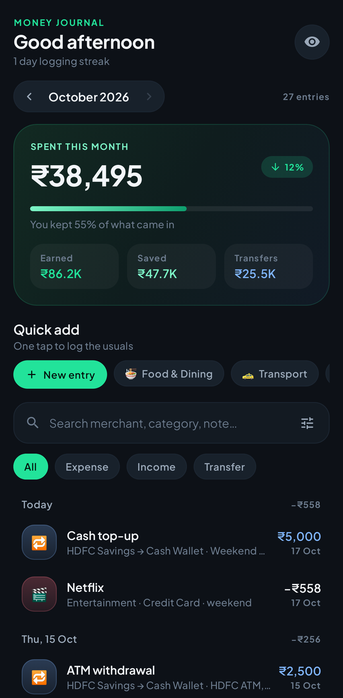
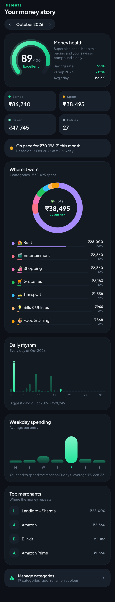
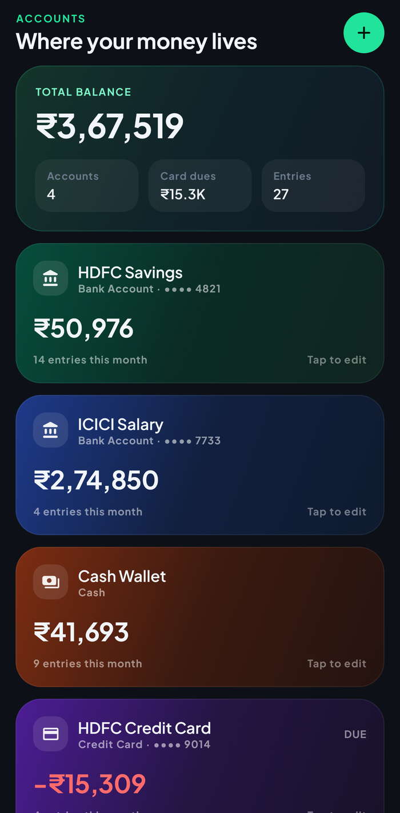
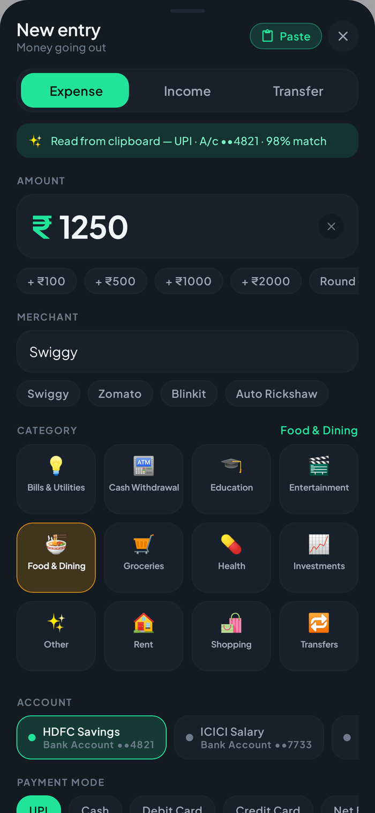
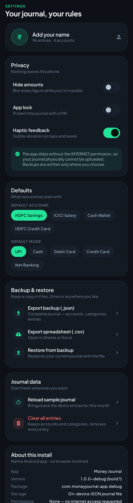
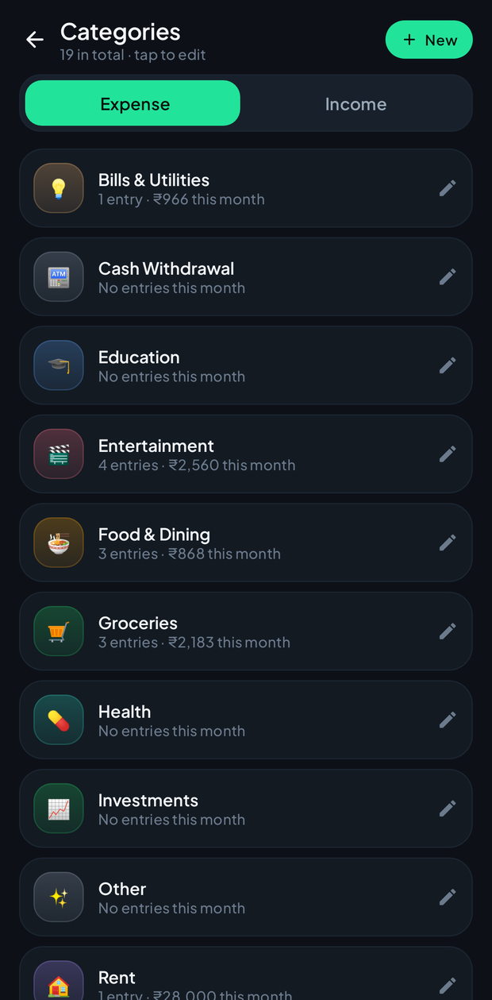

# Money Journal

A premium, dark-mode, **fully offline Indian money journal** for Android.
It is a native Kotlin + Jetpack Compose app — **not a PWA, not a web view** — installed as a normal
signed APK and it deliberately ships **without the INTERNET permission**, so your journal physically
cannot leave the phone.

> Installable: copy `dist/MoneyJournal-1.0.0.apk` to your phone → tap → allow "Install from unknown
> sources" → done. Android 8.0+ (API 26).

---

## Screenshots

| Journal | Insights |
| --- | --- |
|  |  |

| Accounts | Add entry (with Paste) |
| --- | --- |
|  |  |

| Settings | Categories (full screen) |
| --- | --- |
|  |  |

---

## What's inside

**Bottom navigation — exactly five slots**
`Journal` · `Insights` · centered **+** FAB · `Accounts` · `Settings`

**Journal**
- Month selector (chevrons + full-screen month picker), "N entries" count
- Spend hero card: total spent, month-over-month delta chip, savings-rate bar, Earned / Saved / Transfers
- Search across merchant, category, note and amount
- Filter chips (All / Expense / Income / Transfer) plus a filter sheet for account, payment mode and category
- Quick-add chips (most-used categories) and a "New entry" chip
- Date-grouped feed with sticky day headers and per-day totals; tap any row to edit, long-press to delete (with Undo)
- Eye toggle hides every amount for public moments

**Add Entry (bottom sheet)**
- Expense / Income / Transfer tabs with an animated pill
- Amount field with quick chips (+₹100 / +₹500 / +₹1000 / +₹2000 / round-off)
- Merchant (or "Source"/"Description" per tab) with merchant suggestions
- Category grid (4 columns, emoji + colour), account picker, payment mode, date (Today/Yesterday/Calendar), note
- **Paste** — reads the clipboard, parses Indian bank/UPI SMS text, and fills the whole form
- Save / Update / Delete, with validation messages

**Insights**
- Animated money-health ring (0–100 from savings rate, month-over-month trend, consistency)
- Earned / Spent / Saved / Entries tiles, month-pace projection
- Donut chart with tappable legend (category share of spend)
- Daily rhythm bar chart (scales past one-off spikes, marks clipped bars, highlights today)
- Weekday spending averages, top merchants, and **Manage categories** → full-screen Categories

**Categories (full screen)**
- Expense / Income tabs, per-category monthly count and total, add / edit / recolour / delete
- Deleting a category moves its entries to "Other", never losing data

**Accounts**
- Net-balance hero (excludes card dues, reports dues separately)
- Gradient cards for Bank / Cash / Wallet / Credit Card with masked last-4, live balance, entry count
- Add / edit / delete; balances are derived from opening balance + every entry, transfers included

**Settings**
- Privacy: hide amounts, 4-digit app lock (salted SHA-256, auto-lock after 20s in background), haptics
- Defaults: default account, default payment mode
- Backup: export **.json** (full journal) or **.csv**, restore from a file through the system picker
- Journal data: reload the sample journal, clear all entries
- Install info: version, package, "no permissions requested", offline statement

---

## Money model

- Every amount is stored as **paise in a `Long`** (`₹1,250.50 = 125050`). No floats anywhere.
- Display uses **Indian digit grouping** (`₹1,23,45,678`), compact forms (`₹1.2L`, `₹2.4Cr`), and
  paise only when they matter.
- Payment modes: **UPI, Cash, Debit Card, Credit Card, Net Banking**.

## Clipboard parsing (Paste)

Paste reads whatever is on the clipboard and extracts direction, amount, merchant, payment mode,
date, account tail and a category hint — for example:

```
Rs.1,250.00 debited from A/c XX1234 on 12-10-26 to VPA swiggy@axl (Swiggy). UPI Ref 123456789012. -HDFC Bank
→ Expense · ₹1,250 · Swiggy · UPI · A/c ••1234 · 12 Oct 2026 · Food & Dining · Ref 123456789012

INR 349.00 spent on your HDFC Bank Credit Card ending 1234 at AMAZON on 05-10-26.
→ Expense · ₹349 · Amazon · Credit Card · 05 Oct 2026 · Shopping

Your A/c XX4821 is credited with Rs 85,000.00 on 01-10-26 from VPA nexora@okhdfcbank (Nexora Technologies).
→ Income · ₹85,000 · Nexora Technologies · UPI · 01 Oct 2026
```

`SmsParser` deliberately ignores `Avl Bal …`/`Closing balance` values, account and card numbers,
out-of-future dates and unrelated clipboard text (e.g. an OTP message).

---

## Architecture

```
app/src/main/java/com/moneyjournal/app/
├── MoneyJournalApp.kt        Application: owns the single repository
├── MainActivity.kt           Edge-to-edge host, splash, app-lock grace period
├── data/
│   ├── Models.kt             @Serializable Txn / Account / Category / Settings / AppData
│   ├── Money.kt              paise ⇄ display, Indian grouping, parsing
│   ├── SmsParser.kt          Indian bank/UPI SMS → ParsedEntry
│   ├── Analytics.kt          summaries, breakdowns, daily/weekday, health score, balances
│   ├── DemoData.kt           default categories/accounts + a realistic 3-month sample journal
│   ├── DateFormats.kt        month/day labels
│   └── JournalRepository.kt  JSON store, CRUD, backup/restore, PIN security
└── ui/
    ├── RootApp.kt            5-slot bottom bar, centred FAB, NavHost, lock & loading screens
    ├── JournalViewModel.kt   filters, editor state, every user action
    ├── JournalScreen.kt      hero, search, filters, quick-add, grouped feed
    ├── InsightsScreen.kt     health ring, stats, donut, daily/weekday, merchants
    ├── CategoriesScreen.kt   full-screen category manager + editor sheet
    ├── AccountsScreen.kt     gradient cards + account sheet
    ├── SettingsScreen.kt     privacy, defaults, backup, install info
    ├── AddEntrySheet.kt      the premium add/edit sheet
    ├── components/           Chart.kt, Common.kt, TransactionRow.kt
    └── theme/                #0d1117 dark theme, Plus Jakarta Sans, accents
```

- **Storage**: one pretty-printed JSON document in `filesDir/money_journal.json`, written atomically
  (temp file → rename) with a rolling `money_journal.safety.json` copy that is restored automatically
  if the primary file is ever unreadable. State is published only *after* the write lands.
- **UI**: Material 3, all charts drawn with Compose `Canvas` (no chart library), animated transitions
  between screens, animated segments/tabs/ring.
- **Threading**: mutations run on an IO dispatcher behind a mutex; the ViewModel exposes `StateFlow`s
  that Compose collects.

## Building

```bash
./gradlew assembleRelease      # signed release APK → app/build/outputs/apk/release/
./gradlew assembleDebug        # debug APK (applicationId suffix .debug, coexists with release)
./gradlew testDebugUnitTest    # 44 logic + persistence tests + 9 rendered screen captures
```

Release signing uses `signing/moneyjournal.jks` (alias `moneyjournal`, password `moneyjournal`).
It is local-only and git-ignored; if you regenerate it, future updates must be signed with the same
key to install over an existing install.

## Testing

| Suite | What it proves |
| --- | --- |
| `MoneyTest` | Indian grouping, ₹ formatting, paise parsing, compaction |
| `SmsParserTest` | 13 real Indian bank/UPI/card SMS samples, direction, mode, date, account tail, category hint, false-positive guards |
| `AnalyticsTest` | summaries, category shares, daily totals, weekday averages, balances incl. transfers, health score behaviour |
| `RepositoryTest` | seed, create/update/delete, sorted feed, category/account deletion rules, JSON backup round-trip, CSV export, rejection of bad backups, PIN lock, corrupt-file recovery |
| `ScreenshotRenderTest` | renders Journal, Insights, Accounts, Settings, Categories and the Add-entry sheet (normal, transfer tab, post-Paste) to PNGs under `app/build/screenshots/` via Robolectric + Roborazzi |

## Data & privacy

- No accounts, no analytics, no SDKs, no network calls — the manifest has no permissions at all
  (only the platform-injected receiver permission for AndroidX).
- Cloud backup of app data is explicitly disabled (`allowBackup=false` + extraction rules).
- Backups are plain JSON you own; restore replaces the current journal after validation and keeps
  your app lock.
- First launch seeds a realistic sample journal so every screen is populated; **Settings → Clear all
  entries** wipes entries (accounts and categories stay) for a clean start.
